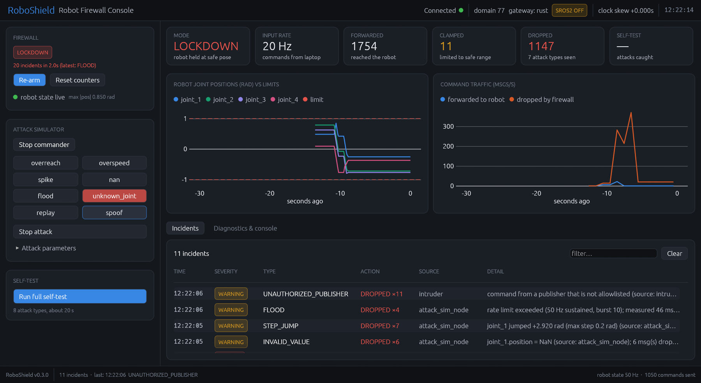
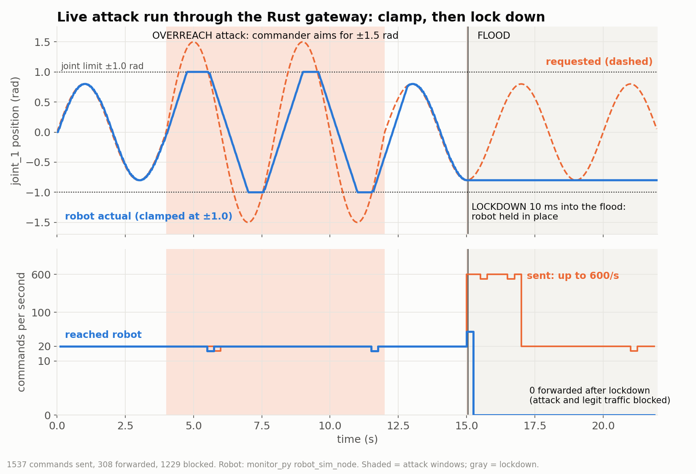
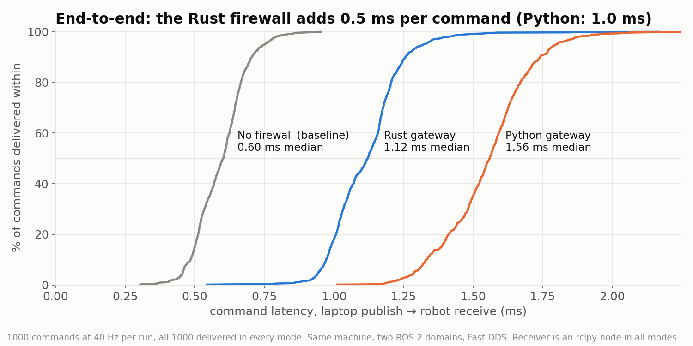
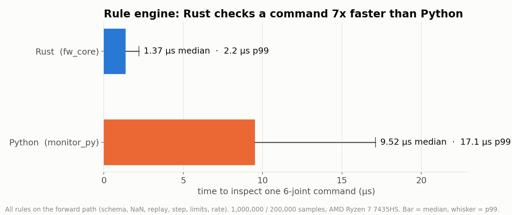
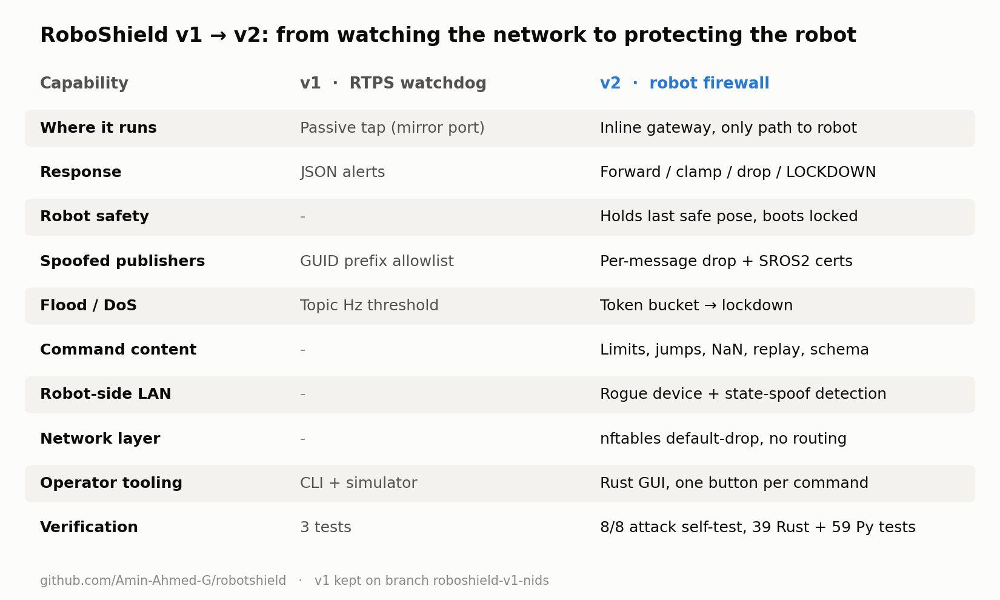

# RoboShield v2: ROS 2 robot command firewall

> **Lineage:** RoboShield v1, the passive RTPS packet watchdog (libpcap NIDS in Rust),
> lives on the [`roboshield-v1-nids`](../../tree/roboshield-v1-nids) branch. v2 moves
> from *watching* the network to *protecting* the robot: an inline gateway that
> inspects every command and can clamp, drop or lock down.

Workspace name: `ros2_monitor_suite`.

A ROS 2 Jazzy package (`src/monitor_py`) for monitoring robot joints and
**firewalling robot commands** on a gateway board such as a NanoPi:

```
Laptop ~~ WiFi ~~ NanoPi (firewall_node) ── Ethernet ── Robot
```

There are two gateway implementations: a **Rust** one in [`rust/`](rust/README.md)
(the default for deployment; adds per-message publisher filtering and a GUI
console) and the original **Python** package. They share topics, params and formats.



## Results

Measured on an AMD Ryzen 7 7435HS laptop (ROS 2 Jazzy, Fast DDS, two ROS domains on
one machine). Reproduce with the scripts in [`bench/`](bench/). Real NanoPi
numbers are still to come.

| | |
|---|---|
| Rule engine, per 6-joint command (Rust) | **1.37 µs** median, 2.2 µs p99 (7x faster than Python) |
| Latency the gateway adds end to end | **+0.5 ms** median (Python gateway: +1.0 ms) |
| Commands delivered in the latency runs | 1000 / 1000 in every mode |
| Attack self-test (SROS2 on, cert-less attacker running) | **8 / 8** detected, robot never past its limit |
| Flood to lockdown | ~10 ms after the flood starts |






| Executable | Runs on | Purpose |
|---|---|---|
| `robot_firewall` (Rust) | gateway | Default gateway. Same role as `firewall_node`, but drops unauthorized publishers message by message. |
| `firewall_console` (Rust) | laptop | GUI with every debugging command as a button, plus a full attack self-test. |
| `firewall_node` | gateway | Bridges the untrusted (WiFi) and trusted (robot) ROS domains. Inspects every command, clamps or drops it, or locks down, and reports each incident. |
| `firewall_dashboard` | laptop | Live terminal view: ARMED/LOCKDOWN state, counters, and an incident feed ("what attack, what we did"). |
| `attack_sim_node` | laptop | Legitimate commander with live attack modes: `overreach overspeed spike nan flood unknown_joint replay spoof`. |
| `robot_sim_node` | robot LAN | Simulated arm that follows commands and holds position on timeout. |
| `joint_monitor_node` | anywhere | Per-joint limit monitor with debounce/hysteresis, rate watchdog, `/diagnostics`, `~/alerts`, `~/reset`. |

## Quick start (one machine, no hardware)

```bash
colcon build --packages-select monitor_py && source install/setup.bash
ros2 launch monitor_py bench.launch.py                     # robot sim + firewall + commander
ROS_DOMAIN_ID=10 ros2 run monitor_py firewall_dashboard     # second terminal
ROS_DOMAIN_ID=10 ros2 service call /firewall/rearm std_srvs/srv/Trigger
ROS_DOMAIN_ID=10 ros2 param set /attack_sim_node attack_mode flood
```

Tests: `colcon test --packages-select monitor_py && colcon test-result --verbose`.
These include unit tests for every rule and an in-process two-domain integration test.

Deploying to real hardware: [deploy/nanopi/README.md](deploy/nanopi/README.md).

## License

MIT, see [LICENSE](LICENSE). Exception: the vendored copy of rclrs in
`rust/vendor/rclrs` remains under its upstream Apache-2.0 license
([rust/vendor/rclrs/LICENSE](rust/vendor/rclrs/LICENSE)).
